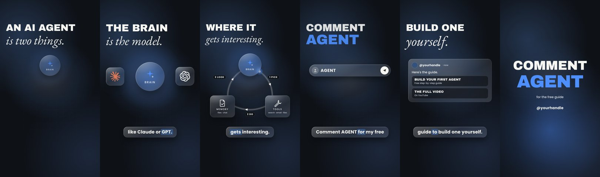

# /reel: a Claude Code skill for faceless short videos

This is the skill I use to make my Instagram Reels, with everything specific to my business taken out. You type `/reel` and a topic, and Claude takes it all the way to a finished vertical video, plus its caption and its cover.



*Frames from the worked example in `skills/reel/example/`, in the default neutral palette.*

What you get for every reel:

- **The video:** 1080x1920, about 30 seconds. One continuous camera world, frosted-glass cards with real app logos, big headlines, captions with the spoken word highlighted, an AI voiceover and subtle sound design.
- **The caption:** a hook line, a short body, your comment-keyword CTA and five hashtags.
- **The cover:** a 9:16 cover that still reads in the profile grid's 3:4 crop.

It never posts anything. You post it yourself.

## How it works

It stops and waits for your OK at each step, because each step is built on the last one:

1. **Script.** About 75 to 100 words, run through a few copy passes so it sounds like a person talking.
2. **Style frame.** One still of the key moment, so you can check the look before any animation.
3. **Voice.** Three takes of the whole script, the best one picked by measuring pitch and pauses, then the gaps between sentences evened out.
4. **Build.** The animation, keyed to the exact word times of the voice, checked frame by frame.
5. **Render.** The MP4, the caption and the cover, delivered together.

Say "go, don't stop to ask" and it builds straight through.

## Install

You need [Claude Code](https://claude.com/claude-code), Node.js (for `npx`), [ffmpeg](https://ffmpeg.org), and Python 3 with `numpy`.

```bash
npx skills add aryanhanda2017-netizen/reel-skill
npx skills add heygen-com/hyperframes
npx skills add blader/humanizer
npx skills add coreyhaines31/marketingskills
```

- `hyperframes` builds and renders the video (HTML + GSAP, rendered locally).
- `humanizer`, plus `social` and `copywriting` from marketingskills, run the copy passes. If you skip them, Claude does the passes itself.

Prefer to copy files by hand? Put the `skills/reel` folder in `~/.claude/skills/reel` (or in your project's `.claude/skills/`).

**A voice.** Pick one: ElevenLabs, Higgsfield or OpenAI (your own account and key), or Kokoro, which runs free on your own machine. Claude tells you what the takes will cost and waits for a yes before spending anything.

## Use it

In Claude Code:

```
/reel how an AI agent actually works, for beginners
```

The first time, it asks you a few questions (your handle, who the reels are for, your comment keyword and what people get for it, your colours, your voice) and saves the answers in the skill's `references/brand.md`. Every reel after that uses them.

## Make it yours

- `references/brand.md`: your handle, audience, CTA, colours, fonts, voice and the words you never want used.
- `references/lessons.md`: every time you correct a reel, Claude writes the lesson here, so the next one starts from it.
- `example/`: a complete 34-second reel ("How an AI agent works") to copy patterns from. See `example/README.md`.

Or just keep talking to Claude: "make the captions bigger", "use my brand colours", "add a cursor that drags the number across". Ask it to save what you like into `brand.md` or `lessons.md`.

## What's inside

```
skills/reel/
  SKILL.md                 the workflow Claude follows
  references/
    brand.md               your settings (filled in on the first run)
    voice.md               script → three takes → measured pick → mastered voice → word times
    motion-build.md        the HyperFrames patterns: camera, glass, headlines, captions, known errors
    lessons.md             your corrections, newest first
  scripts/
    prosody.py             measures pitch range, pitch movement and pauses of each take
    retime_gaps.py         evens out the pauses between sentences and masters to -16 LUFS
    align_words.py         word times from the measured silences (for captions and cues)
    sfx_synth.py           a quiet sound-design bed, synthesized locally
  example/                 the worked example reel (composition, word times, script, SFX cues)
```

## Credits

Built on [HyperFrames](https://github.com/heygen-com/hyperframes). The copy passes use [humanizer](https://github.com/blader/humanizer) and [marketingskills](https://github.com/coreyhaines31/marketingskills).

MIT licensed. Made by Aryan Handa.
